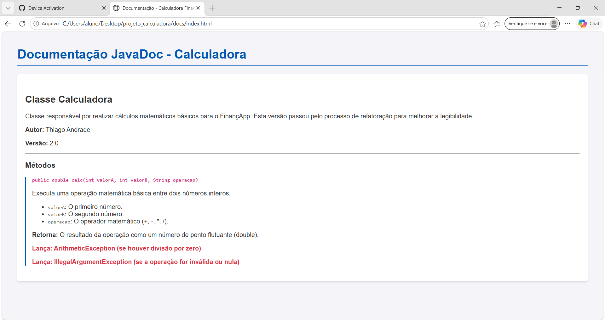

# projeto_calculadora - FinançApp

## Descrição do Projeto
Módulo básico de cálculos matemáticos para a startup fictícia FinançApp. Realiza operações de soma, subtração, multiplicação e divisão, com tratamento de erros.

## Objetivo da Atividade
Desenvolver a capacidade prática na construção de software com testes, tratamento de erros, refatoração, documentação JavaDoc e versionamento.

## Tecnologias Utilizadas
* Java (JDK)
* Git

## Explicação das Operações
* `+` : Soma
* `-` : Subtração
* `*` : Multiplicação
* `/` : Divisão (retorna `ArithmeticException` se o divisor for 0).
* Operações inválidas lançam `IllegalArgumentException`.

## Execução dos Testes
### Testes antes da Refatoração

### Testes após a Refatoração

## Documentação JavaDoc

## Organização do Repositório
* Branch `main`: Código finalizado e README.
* Branch `Refatoracao`: Código com as técnicas de refatoração.

## Link do Repositório
https://github.com/Thiagoblackphotos/Calculadora-ohata.git